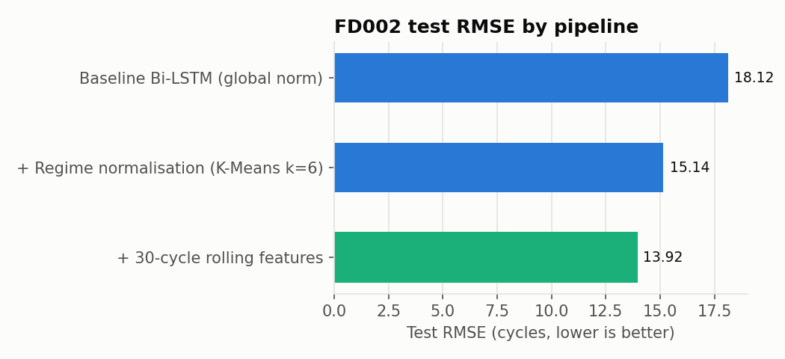
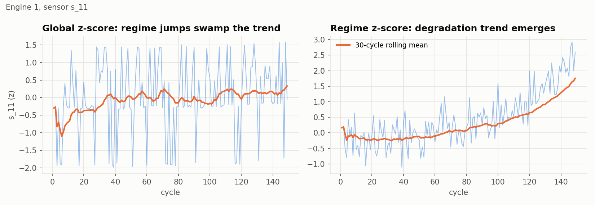
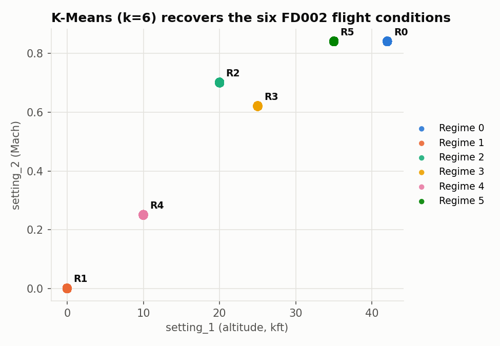

# Turbofan Predictive Maintenance — Multi-Regime RUL Estimation

Remaining Useful Life (RUL) prediction on **NASA CMAPSS FD002**, the six-flight-condition subset.
A standard Bi-LSTM struggles here because altitude, Mach and throttle shift every sensor far more
than engine wear does. This project diagnoses that failure, segments the flight conditions with
K-Means, normalises each sensor *within its regime*, and trains a TensorFlow Bi-LSTM on 30-cycle
sequence tensors with rolling features.

## Results (FD002 test set, 259 engines)

| Pipeline | Features | Test RMSE ↓ | NASA score ↓ |
|---|---:|---:|---:|
| Baseline Bi-LSTM (global normalisation) | 21 | 18.12 | 2,578 |
| + K-Means (k=6) regime normalisation | 23 | 15.14 | 1,225 |
| + 30-cycle rolling mean/std features | 57 | **13.92** | **1,076** |

**RMSE 18.12 → 13.92 (−23%)**, NASA asymmetric score −58%. RMSE is measured on the last window
of each test engine against ground truth capped at 125 cycles (the usual CMAPSS convention).
Exact numbers vary slightly with hardware and TensorFlow version.



## 1. Diagnosis: why the baseline fails

`train.py` prints two diagnostics before training:

- **Variance explained by flight regime alone** — for 19 of 21 sensors, ≥99% of variance comes
  from which of the six operating conditions the engine was in, not from degradation.
- **|Correlation with RUL|** — under global normalisation the best sensor reaches only 0.09.
  After per-regime normalisation, `s_11` reaches 0.77, `s_4` 0.74 and `s_15` 0.72.



## 2. Regime segmentation

K-Means (k=6) on the three standardised operational settings recovers the six flight
conditions exactly. The fitted clusterer is applied unchanged to the test set.



## 3. Pipeline

1. **Load** `train/test/RUL_FD002.txt` (downloaded from Kaggle automatically).
2. **Target**: piecewise-linear RUL, capped at 125 cycles.
3. **Regimes**: K-Means (k=6) on `setting_1..3`.
4. **Condition-specific normalisation**: per-regime mean/std fitted on train only. Sensors that
   are constant inside every regime (they only encode flight condition) are dropped.
5. **Rolling features**: causal 30-cycle rolling mean and std per sensor, per engine.
6. **Regime one-hot** so the model knows the operating condition of each cycle.
7. **3D tensors**: sliding windows of shape `(samples, 30, features)`; short test engines are
   left-padded.
8. **Model**: Bi-LSTM(64) → Dropout → Bi-LSTM(32) → Dropout → Dense(32) → Dense(1), MSE loss,
   Adam, early stopping. Validation split is by **engine**, so no window leakage.

## Dataset

Downloaded directly from Kaggle with `kagglehub`:

- Primary: https://www.kaggle.com/datasets/behrad3d/nasa-cmaps
- Fallback: https://www.kaggle.com/datasets/palbha/cmapss-jet-engine-simulated-data

Public datasets usually download without credentials. If Kaggle asks for auth, create an API
token at https://www.kaggle.com/settings and save it to `~/.kaggle/kaggle.json`.
Manual option: download the zip and put `train_FD002.txt`, `test_FD002.txt`, `RUL_FD002.txt`
in `data/raw/`.

## Quick start

```bash
pip install -r requirements.txt
python train.py               # diagnosis + all three experiments (~30 min on CPU)
python train.py --epochs 3    # fast smoke test
python train.py --only final  # just the full pipeline
```

Outputs: `results/metrics.json`, `results/figures/*.png`, `models/bilstm_*.keras`.

## Project structure

```
turbofan-rul/
├── train.py              # entry point: diagnosis → experiments → metrics & plots
├── requirements.txt
├── src/
│   ├── config.py         # paths, Kaggle slugs, hyper-parameters
│   ├── data.py           # Kaggle download + loading + RUL labels
│   ├── features.py       # K-Means regimes, normalisers, rolling features, 3D windows
│   ├── model.py          # Bi-LSTM, training loop, RMSE & NASA score
│   └── diagnostics.py    # regime variance analysis + figures
└── results/
    ├── metrics.json
    └── figures/
```

## Reference

A. Saxena, K. Goebel, D. Simon, N. Eklund, "Damage Propagation Modeling for Aircraft Engine
Run-to-Failure Simulation", PHM 2008.
